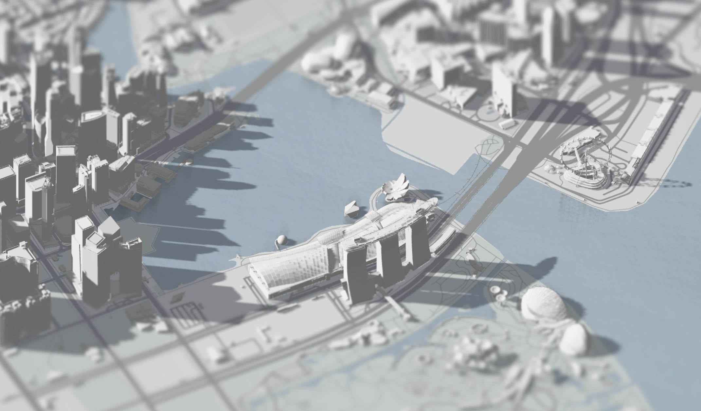

Singapore buildings 3D Tiles from OneMap 3D
===

[](https://om3d.netlify.app/)
[](https://om3d.netlify.app/)

This is a demo of Singapore buildings 3D tiles from [OneMap 3D](https://www.onemap.gov.sg/3d), rendered with [Three.js](https://threejs.org/) and [3d-tiles-renderer](https://github.com/NASA-AMMOS/3DTilesRendererJS) in an orthographic view.

Development
---

Requires Node.js 24+ (Vite 8).

``` bash
# install dependencies
npm i

# Start local server on http://localhost:5931
# (also reachable over the LAN for phone testing)
npm run dev

# Production build into ./dist
npm run build

# Preview the production build on http://localhost:5932
npm run serve
```

Tiles
---

This uses [3d-tiles-renderer](https://github.com/NASA-AMMOS/3DTilesRendererJS)
to render [3D Tiles](https://www.ogc.org/standards/3dtiles) with Three.js.

The raw files in `./tiles` (current) and `./tiles-old` (2021) and any
intermediate `./optimized-tiles/**/*.glb` files are excluded from this
repository. The optimized `.b3dm` tiles in `./optimized-tiles` are checked in;
they are generated from the current OneMap 3D dataset with depth-8 selection,
hole filling, and per-building simplification. The 2021 optimized snapshot is
kept locally as the ignored `./optimized-tiles-old`.

``` bash
# Download tiles from OneMap to ./tiles/*
# The full current dataset is enormous: check before downloading!
npm run fetch-tiles -- --dry-run
npm run fetch-tiles -- --max-level=5
npm run fetch-tiles

# Download the full dataset and strip the photogrammetry textures on the fly.
# The download is still ~130–175 GB, but only ~2.3 GiB is written to disk.
npm run fetch-tiles -- --output=tiles --strip-textures --max-bytes=5368709120

# Retry tiles that failed and were written to ./tiles/failures.txt
npm run retry-tiles -- --output=tiles

# Build the simplified tileset into ./optimized-tiles
# (depth 8 + fill, deeper MBS override, crease-preserving simplification)
npm run build-toy-tiles
```

Append `?tiles=<path-to-tileset.json>` to the dev URL to preview another
tileset. The page defaults to `optimized-tiles`.

Use `?shadows=1` to start with shadows enabled, and `?renderer=webgl`,
`?renderer=webgl2`, or `?renderer=webgpu` to pick the renderer (the default is
WebGPU with a WebGL fallback). The settings gear (top right) holds Quality
(Low / Medium / High), tilt shift, and shadows; Quality also accepts
`?quality=low|medium|high`. Add `?debug=1` to log the view state during camera
moves. The basemap is OpenFreeMap vector tiles and needs no API key.

The current upstream dataset has ~24,600 tiles and is roughly 130–175 GB in
total, so prefer `--dry-run` and `--max-level=N` while experimenting.
`--strip-textures` removes the images and keeps the Draco geometry; buildings
then render with flat gray materials. See [AGENTS.md](AGENTS.md) for the
current endpoint, stripper behavior, and the sampling behind that estimate.

### Tile size (current optimized set)

| | Current (`optimized-tiles/`) |
| --- | ---: |
| Tiles | 6,810 |
| Tile data | ~505 MiB |
| Average per tile | ~75 KB |

Copyright
---

@ [SLA](https://www.sla.gov.sg/) @ [OneMap](https://www.onemap.gov.sg/legal/termsofuse.html)
