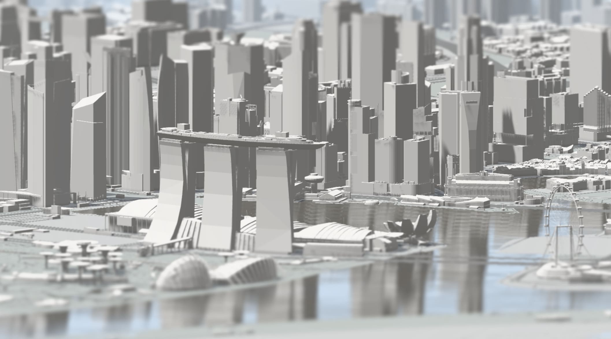

Singapore buildings 3D Tiles from OneMap 3D
===

[](https://om3d.netlify.app/)
[](https://om3d.netlify.app/)

This is a demo of Singapore buildings 3D tiles from [OneMap 3D](https://www.onemap.gov.sg/3d), rendered with [Three.js](https://threejs.org/) and [3d-tiles-renderer](https://github.com/NASA-AMMOS/3DTilesRendererJS) in an orthographic view.

Features
---

- **Orthographic city view.** Buildings are clay-shaded, with a basemap that
  streams in as you pan. `camera.zoom` maps to roughly Mapbox z16.5 at the
  initial framing and z22 at the maximum.
- **Streaming 3D tiles.** The simplified OneMap 3D tileset (~6,800 tiles) is
  loaded through `3d-tiles-renderer` with distance-based LOD and an LRU tile
  cache, so detail follows the camera instead of loading everything upfront.
- **Vector basemap without an API key.** OpenFreeMap (OpenMapTiles schema)
  tiles are rasterized into shared canvas textures and layered by zoom, with
  roads, land use, water, and the Singapore outline.
- **Reflective water.** A planar reflection of the scene is projected onto the
  water surface, softened by a static normal map and a vertical blur, then
  faded into the sky toward the horizon so the ocean does not run to the edge.
- **Sky, sun glow, and horizon haze.** A camera-facing gradient plane supplies
  the sky, the sun is painted into it as a soft haze, and tilt-driven fog hides
  the far edge of the map.
- **Optional shadows.** A time-of-day sun casts shadows through a tinted
  catcher; shadow map resolution follows the quality tier.
- **Optional time-of-day lighting.** A sun slider moves the sun by true solar
  elevation for the current date, re-tinting the key/fill/hemisphere lights,
  sky, fog, basemap, and water together. The panel shows sunrise/sunset and a
  Dawn/Day/Dusk phase, with a button to snap back to the current time.
- **Ambient occlusion and contact shade.** GTAO darkens building joints, and a
  soft ground-level shade grounds the buildings (medium/high tiers).
- **Tilt shift and vignette.** A depth-of-field-style blur fades in at low zoom
  and out as detail increases.
- **Map-style controls.** Drag to pan with inertia, wheel/pinch to zoom,
  ctrl/meta/shift + drag or a two-finger twist to rotate, two-finger drag to
  tilt, stepped rotate (30°) and tilt (15°) pill buttons, and a compass button
  that eases back to north.
- **WebGL and WebGPU renderers.** The default is a WebGPU node renderer with a
  classic WebGL fallback; `?renderer=webgl|webgl2|webgpu` forces a path. Every
  effect is implemented on both.
- **Quality tiers and settings.** Low/Medium/High tiers are auto-detected from
  the device and can be overridden in the settings panel (persisted in
  `localStorage`) or with `?quality=low|medium|high`. The panel also holds tilt
  shift, shadows, lighting, and a "Copy debug info" button.

### Quality modes

The three tiers trade basemap detail, tile density, and effects for memory and
GPU cost. Mobile and low-memory devices select `low` automatically; a manual
choice overrides detection.

| Setting | Low | Medium | High |
| --- | --- | --- | --- |
| Max pixel ratio | 1 | 1.25 | 1.5 |
| Basemap tile size | 512 px | 512 px | 512 px |
| Max basemap tiles | 28 | 64 | 256 |
| Concurrent basemap loads | 2 | 5 | 10 |
| Basemap level cleanup delay | 500 ms | 1200 ms | 2000 ms |
| Vector tile cache | 64 | 128 | 256 |
| 3D tile error target (idle / moving) | 24 / 40 | 14 / 24 | 8 / 16 |
| Max tiles processed | 100 | 180 | 300 |
| Tile cache (min–max items) | 200–500 | 350–1000 | 600–2000 |
| Tile cache (min–max bytes) | 32–96 MB | 64–192 MB | 192–512 MB |
| Ambient occlusion | off | on (half-res) | on (half-res) |
| Shadow map | 1024 px, Basic | 2048 px, PCF | 4096 px, PCF |
| Shadows paused while panning | yes | no | no |
| Water | flat, unlit | reflection at 0.25 scale | reflection at 0.4 scale |
| Coverage pass / active-tile display | off | on with shadows | on with shadows |
| Frame path | direct when effects are off | composer/pipeline | composer/pipeline |

Development
---

Requires Node.js 24+ (Vite 8).

``` bash
# install dependencies
npm i

# Start local server on http://localhost:5931
# (also reachable over the LAN for phone testing)
npm run dev

# Production build into ./dist
npm run build

# Preview the production build on http://localhost:5932
npm run serve
```

Tiles
---

This uses [3d-tiles-renderer](https://github.com/NASA-AMMOS/3DTilesRendererJS)
to render [3D Tiles](https://www.ogc.org/standards/3dtiles) with Three.js.

The raw files in `./tiles` and any intermediate `./optimized-tiles/**/*.glb`
files are excluded from this repository. The optimized `.b3dm` tiles in
`./optimized-tiles` are checked in; they are generated from the current OneMap
3D dataset with depth-8 selection, hole filling, and per-building
simplification.

``` bash
# Download tiles from OneMap to ./tiles/*
# The full current dataset is enormous: check before downloading!
npm run fetch-tiles -- --dry-run
npm run fetch-tiles -- --max-level=5
npm run fetch-tiles

# Download the full dataset and strip the photogrammetry textures on the fly.
# The download is still ~130–175 GB, but only ~2.3 GiB is written to disk.
npm run fetch-tiles -- --output=tiles --strip-textures --max-bytes=5368709120

# Retry tiles that failed and were written to ./tiles/failures.txt
npm run retry-tiles -- --output=tiles

# Build the simplified tileset into ./optimized-tiles
# (depth 8 + fill, deeper MBS override, crease-preserving simplification)
npm run build-toy-tiles
```

Append `?tiles=<path-to-tileset.json>` to the dev URL to preview another
tileset. The page defaults to `optimized-tiles`.

Use `?shadows=1` to start with shadows enabled, and `?renderer=webgl`,
`?renderer=webgl2`, or `?renderer=webgpu` to pick the renderer (the default is
WebGPU with a WebGL fallback). The settings gear (top right) holds Quality
(Low / Medium / High), tilt shift, and shadows; Quality also accepts
`?quality=low|medium|high`. Add `?debug=1` to log the view state during camera
moves. The basemap is OpenFreeMap vector tiles and needs no API key.

The current upstream dataset has ~24,600 tiles and is roughly 130–175 GB in
total, so prefer `--dry-run` and `--max-level=N` while experimenting.
`--strip-textures` removes the images and keeps the Draco geometry; buildings
then render with flat gray materials. See [AGENTS.md](AGENTS.md) for the
current endpoint, stripper behavior, and the sampling behind that estimate.

### Tile size (current optimized set)

| | Current (`optimized-tiles/`) |
| --- | ---: |
| Tiles | 6,810 |
| Tile data | ~505 MiB |
| Average per tile | ~75 KB |

Copyright
---

Basemap @ [OpenFreeMap](https://openfreemap.org/) @ [OpenMapTiles](https://openmaptiles.org/) @ [OpenStreetMap](https://www.openstreetmap.org/copyright)<br>
3D tiles @ [SLA](https://www.sla.gov.sg/) @ [OneMap](https://www.onemap.gov.sg/legal/termsofuse.html)
